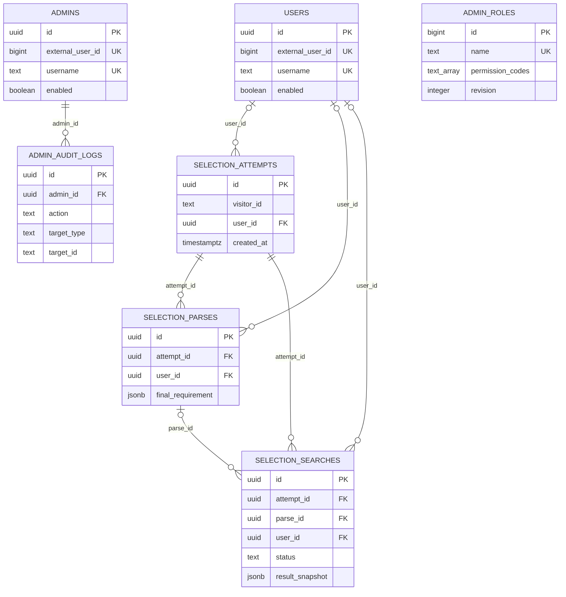
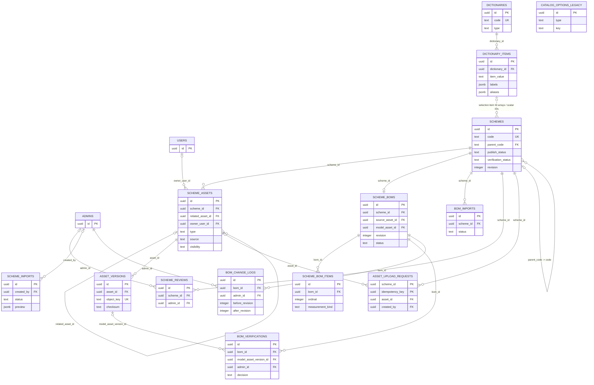
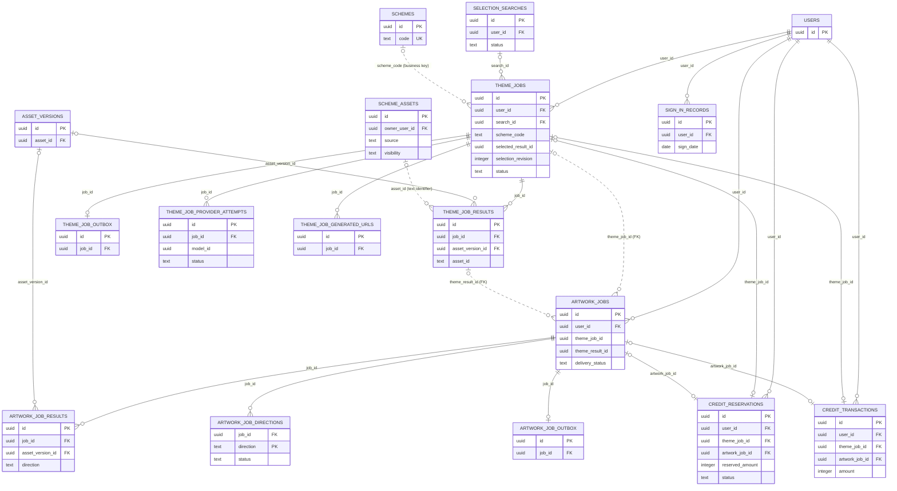
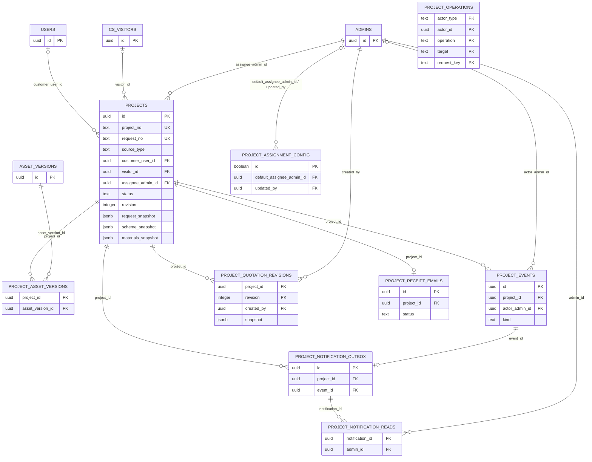
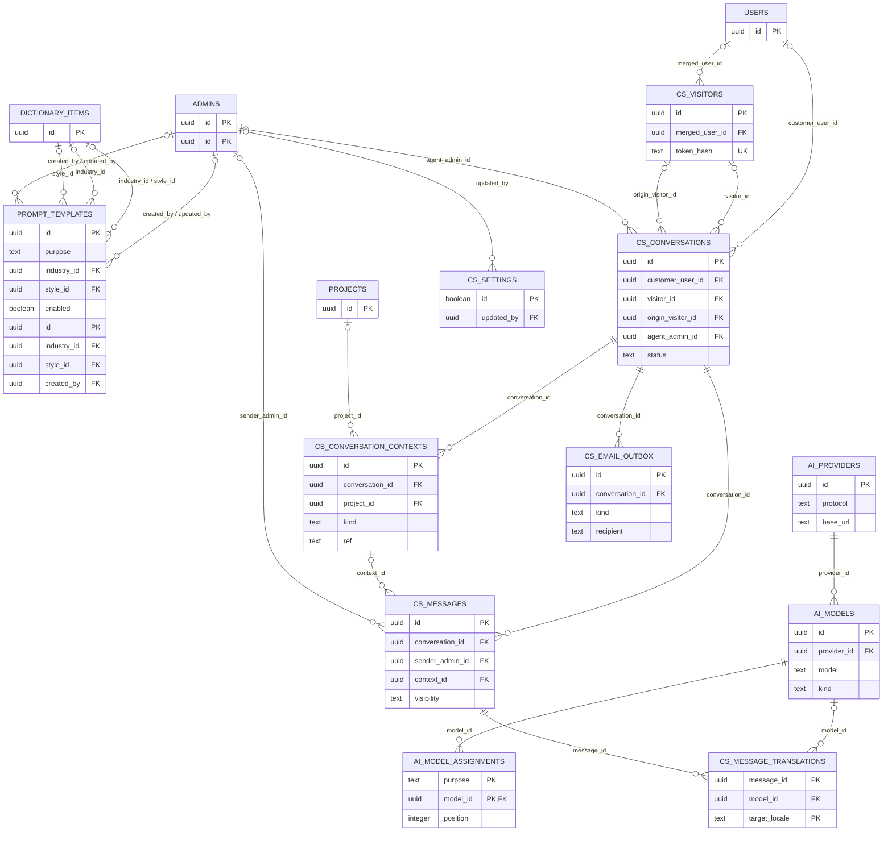

# 服务端数据库 ER 图

## 口径

以下图表根据 `apps/server/migrations/001_*.sql` 至 `080_*.sql` 的最终结构整理。图中覆盖业务主表及主要外键；逐表职责、关键字段和业务约束见[全量表设计目录](全量表设计目录.md)。运行维护与归档表在本文末尾单独成图/列出。

- `||--o{`、`o|--o{` 等关系标记表示数据库外键，基数按当前字段可空性与唯一约束表达。
- `..>` 虚线表示业务逻辑关联：可能由业务号、字段值、JSON 快照或代码校验实现，不是外键约束。
- 图中标注 `view` 的对象是数据库视图，不是基础表。
- 迁移中已删除的表不画入当前模型，例如 `manual_requests`、`ai_model_configs` 和 `applicability_questions`。
- `project_operations` 是幂等操作回执表，`foundation_*` 是基础任务示例表；它们不代表项目领域或生成领域的全部运行时机制。

## 身份与智选



`selection_attempts.visitor_id` 是访客标识文本，不引用客服访客表。管理员角色通过外部角色 ID/同步数据与本地 `admin_roles` 协作，`admins` 表不以外键关联角色表。

## 方案、资产与资料



`scheme_boms.scheme_id` 唯一，因此每个方案至多一条当前清单主记录。方案的行业/功能分区/特征多选项以 UUID 数组存放，没有逐项外键；单选字典字段则有外键。迁移备份表和 opening direction 归档表列在本文末尾。`scheme_baseline_assets` 是按公共方案来源过滤的 `scheme_assets` 视图。

## 生成与积分



主题任务的 `selected_result_id` 与 `theme_job_results.id` 之间由生成模块校验，不是数据库外键。主题结果 `asset_id` 为文本标识；生成资产与 `scheme_assets` 的关联、方案编码与 `schemes` 的关联也不是外键。`user_credit_balances` 是对 `credit_transactions` 聚合得到的视图。

## 项目与报价



询价和人工需求的具体内容存放在 `projects.request_snapshot`，来源通过 `source_type` 区分；当前 schema 没有活动 `quote_requests` 或 `manual_requests` 表。方案、主题结果、清单与其他修订信息以快照 JSON 保存，不以外键连接源记录。`project_operations.actor_id` 是多态主体标识，因此不连到 users/admins 外键。

## AI 配置、提示词与客服



客服上下文中的方案 `ref` 是方案编号文本，不是外键；`project_id` 是可选的实际外键。客服翻译用途通过 `ai_model_assignments.purpose` 指向 AI 模型。邮件 outbox、设置及翻译状态属于投递与运营数据，不是会话消息本身。

## 运行、审计与支撑表

```mermaid
erDiagram
  FOUNDATION_TASKS {
    uuid id PK
    text request_key UK
    text kind
    text status
    jsonb payload
  }
  FOUNDATION_OUTBOX {
    uuid id PK
    uuid task_id FK_UK
    timestamptz published_at
  }
  SCHEMA_MIGRATIONS {
    text version PK
    text checksum
    timestamptz applied_at
  }
  ADMIN_AUDIT_LOGS {
    uuid id PK
    uuid admin_id FK
    text target_type
    text target_id
  }
  DICTIONARIES {
    uuid id PK
    text code UK
  }
  DICTIONARY_ITEMS {
    uuid id PK
    uuid dictionary_id FK
    text item_value
  }
  SIGN_IN_CONFIG {
    boolean id PK
    boolean enabled
    integer daily_amount
    text timezone
  }
  PROJECT_ASSIGNMENT_CONFIG {
    boolean id PK
    uuid default_assignee_admin_id FK
    uuid updated_by FK
    integer revision
  }
  PROJECT_OPERATIONS {
    text actor_type PK
    uuid actor_id PK
    text operation PK
    text target PK
    text request_key PK
  }
  SCHEME_SELECTION_MIGRATION_BACKUP {
    uuid id
    text code
    jsonb legacy_values
  }
  SCHEME_OPENING_DIRECTIONS_ARCHIVE {
    uuid scheme_id
    text_array opening_directions
  }
  RETIRED_SIZE_DICTIONARY_BACKUP {
    jsonb dictionary
    jsonb item
  }
  IMPORTED_DIMENSION_ORIENTATION_BACKUP {
    uuid id
    text code
  }
  FOUNDATION_TASKS ||--o| FOUNDATION_OUTBOX : "task_id"
  ADMINS ||--o{ ADMIN_AUDIT_LOGS : "admin_id"
  DICTIONARIES ||--o{ DICTIONARY_ITEMS : "dictionary_id"
```

`schema_migrations` 由迁移 runner 创建，不在编号 SQL 迁移中。`catalog_options_legacy` 是迁移 012 将旧 `catalog_options` 改名后保留的历史表；下列 `_backup` / `_archive` 表用于迁移数据留档，不属于活跃业务写模型。

数据库还包含以下支撑实体：

- `booth_sizes` 不是独立表，是 `dictionaries` / `dictionary_items` 中 `booth_size` 字典及其尺寸字段。
- `bom_change_logs`、`scheme_imports`、`admin_audit_logs`、`sign_in_config`、`project_assignment_config` 等活跃支撑表已纳入[全量表设计目录](全量表设计目录.md)。
- 主题任务缓存和选型关联通过 `theme_jobs` 的 `cache_key`、`cached_from_job_id`、`search_id` 等字段表达，不另设缓存或检索表。
- 积分对账问题通过 `theme_jobs`、`artwork_jobs` 的 `credit_issue` 字段和积分模块的重充幂等记录表达。
- `foundation_tasks` / `foundation_outbox` 是基础设施示例任务。

需要核对完整字段、索引和删除动作时，直接查看 `apps/server/migrations/` 中按序执行的迁移；本图不替代迁移文件或数据库 introspection。
