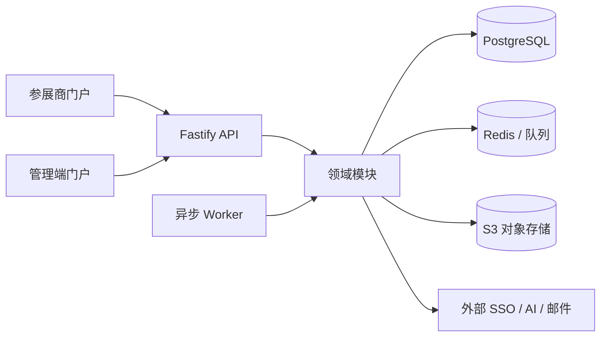
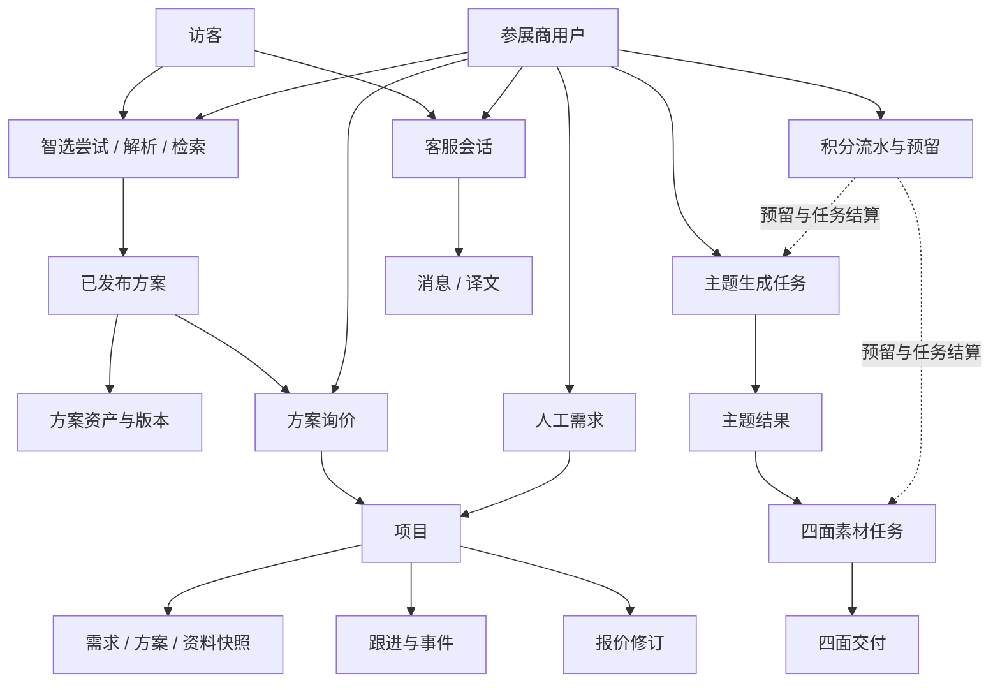

# 服务端领域模型

## 范围与架构

服务端是按业务领域组织的模块化单体，由 Fastify API 和独立异步 Worker 组成，共享 PostgreSQL、Redis、对象存储和外部 AI 服务。client 与 admin 是访问门户，不是业务领域边界；它们调用同一组领域能力。

领域模块位于 `apps/server/src/modules/`。`http/` 负责协议、鉴权、校验和响应映射；`workers/` 负责 Outbox 投递、恢复、调度和外部通知；`infra/` 提供数据库、Redis、队列、存储和 AI 协议适配等技术能力。业务模块不得依赖 HTTP 门户或 Worker 调度实现，跨模块依赖由 `tests/architecture/module-boundaries.test.ts` 白名单约束。

## 业务上下文

| 上下文 | 主要模块 | 负责的事实 |
|---|---|---|
| 身份与访问 | `identity`、`client-sign-in` | 外部账号同步、本地用户与管理员、请求主体、会话版本、角色权限及登录后的访客数据归属编排 |
| 方案目录与资料 | `schemes`、`assets`、`dictionaries` | 方案资料、审核发布、资产和文件版本、清单、字典与方案就绪规则 |
| 智能选型 | `selection` | 自然语言解析、结构化条件、方案匹配、检索历史与分析记录 |
| 生成与积分 | `generation`、`credits`、`prompts`、`ai-models` | 主题及四面素材任务、提示词、AI 配置、积分预留/结算/释放、结果交付 |
| 项目承接 | `projects` | 询价及人工需求统一承接、项目状态和修订、方案/资料快照、分配、事件、通知及报价版本 |
| 在线客服 | `customer-service` | 访客、会话、上下文、消息、翻译、邮件通知和保留期 |
| 运维与聚合查询 | `tasks`、`dashboard`、`audit` | 基础任务、跨模块运营统计和管理审计等支撑能力 |

上述是职责边界，不保证每个领域对应一组独立数据库表。部分业务引用通过业务编号、JSON 快照或代码校验建立，详见 [数据库 ER 图](数据库ER图.md)。

## 核心概念关系

图中虚线表示业务协作或生命周期关系，不表示每条关系均由外键约束。生成结果与项目交付引用会固定资产版本；方案询价中的方案编号、主题选择和资料修订会在创建项目时转为快照，后续源数据变化不应改写历史请求事实。

## 核心生命周期

### 方案选型与资料

方案先以草稿维护基础信息和资产；审核/就绪状态与发布状态分开表达。只有满足发布规则的方案进入公开匹配。公开资料通过 `scheme_baseline_assets` 视图限定为公共方案资产；生成结果保留用户归属和私有可见性。资产替换新增 `asset_versions` 行，历史项目或交付可固定旧版本。

清单、报馆图、平面素材等各有自己的内容、审核或修订语义。方案发布校验组合这些模块的就绪情况，但不把它们合并成一个共享资料实体。

### 智选到生成

智选尝试可记录需求解析和多次检索。检索保存当时条件及结果快照，用于历史呈现和运营分析，不应被解释为对方案的预订或项目创建。

主题和四面素材均为异步任务。任务创建、积分预留和 Outbox 记录须在事务中保持一致；Worker 取出后调用外部模型时不持有数据库锁。结果、供应商尝试和交付状态用于恢复、幂等结算及诊断。积分流水和预留只能由 `credits` 模块写入；生成任务表由 `generation` 模块与 generation Worker 写入。

四面素材任务可引用用户选定的主题结果及其选择修订。完成生成不等于资料齐备，方向级状态与整体交付状态共同确定能否交付。

### 询价到项目

方案询价和人工需求是两种项目来源，最终共用 `projects` 承接流程。当前实现不保留单独的活动请求表；客户联系信息、原始描述、确认条件、入口和方案资料等写入请求快照。项目有当前状态及递增修订；跟进、分配变更和其他动作保留为项目事件。报价按项目保存不可变修订。

登录用户提交的项目关联 `users`。匿名项目可有客服访客关联，但客服访客关联不代表客户账号归属。项目授权依赖已验证的主体和业务规则，不能依赖 UUID 不可猜测性。

### 在线客服

客服会话由恰好一种客户身份发起：已登录用户或访客。客服访客可在登录时合并到用户，会话具有独立排队、坐席、关闭和未读状态。消息按序列记录，可包含公开消息、内部备注、上下文与系统事件；译文按消息和目标语言维护。邮件与翻译通过待处理记录驱动异步投递。

## 重要不变量

- 用户与管理员是两种本地身份主体；认证会话由 Redis 管理，不是数据库中的业务实体。
- 方案资产与文件内容分离：资产表达逻辑归属，`asset_versions` 表达不可变文件版本。
- `scheme_baseline_assets` 只包含公共方案资产；主题/四面素材生成资产不得混入公共基线。
- 生成任务写入、Outbox 与积分预留在同一事务建立；积分账本与任务表有独立写入归属。
- 调用 AI 或其他外部 API 时不持有数据库行锁；Outbox 和租约负责投递与恢复。
- 项目请求、方案、资料和报价历史使用快照或不可变修订；不可将历史记录动态解析为最新源数据。
- 客服访客和会话不替代用户身份、项目归属或项目授权。
- ER 图的虚线是代码层逻辑关联；只有实线外键才由 PostgreSQL 关系约束直接保证。

## 代码入口

| 主题 | 入口 |
|---|---|
| 领域依赖与表写入规则 | `apps/server/tests/architecture/module-boundaries.test.ts` |
| 方案基线资产 | `apps/server/migrations/050_asset_scope.sql`、`apps/server/src/modules/schemes/`、`apps/server/src/modules/assets/` |
| 生成、Outbox 与恢复 | `apps/server/src/modules/generation/`、`apps/server/src/workers/generation-outbox.ts`、`apps/server/src/workers/generation-recovery.ts` |
| 积分账本 | `apps/server/src/modules/credits/` |
| 项目与报价 | `apps/server/src/modules/projects/`、`apps/server/migrations/035_projects.sql`、`apps/server/migrations/036_project_quotations_and_manual_migration.sql` |
| 在线客服 | `apps/server/src/modules/customer-service/`、`apps/server/migrations/075_customer_service.sql` |
